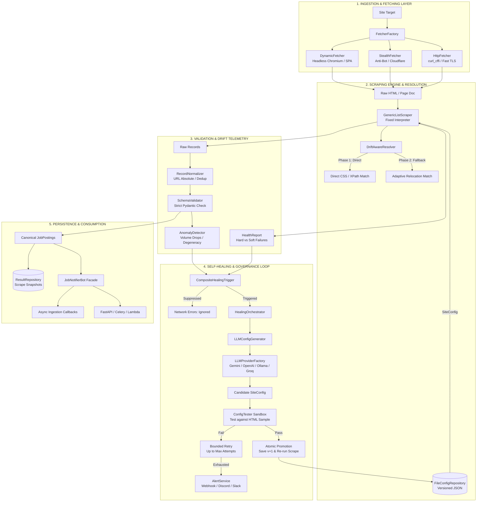
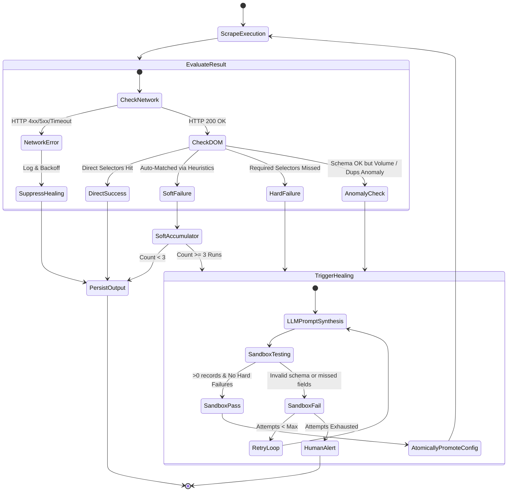
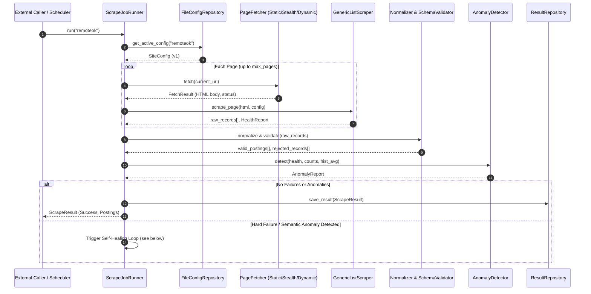
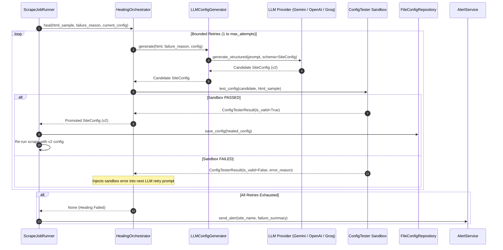

# Job Notifier Bot: Autonomous Self-Healing Scraper & Ingestion Platform

An enterprise-grade, resilient job ingestion and notification engine engineered for continuous execution in volatile web environments. The system pairs **zero-LLM, ultra-fast deterministic execution during steady state** with **sandboxed, LLM-driven autonomous self-healing** when structural DOM shifts or selector drift are detected.

---

## Architecture at a Glance

```text
                         ┌─────────────────────────────────┐
                         │   Scheduled Trigger / Cron      │
                         └────────────────┬────────────────┘
                                          │
                                          ▼
                         ┌─────────────────────────────────┐
                         │       ScrapeJobRunner           │
                         │    Orchestrates Site Runs       │
                         └────────────────┬────────────────┘
                                          │
            ┌─────────────────────────────┴─────────────────────────────┐
            ▼                                                           ▼
┌───────────────────────────────┐                       ┌───────────────────────────────┐
│     Steady-State Pipeline     │                       │     Autonomous Self-Healing   │
│  • Fetcher (curl_cffi/stealth)│                       │  • Multi-Tier Trigger Check   │
│  • GenericListScraper engine  │                       │  • Bounded LLM Config Synth   │
│  • DriftAwareResolver (2-tier)│   Hard Fail / Drift   │  • Deterministic HTML Sandbox │
│  • Schema & Anomaly Validator ├──────────────────────►│  • Atomic Version Promotion   │
│  • Async Ingestion Callbacks  │                       │  • Human Escalation Fallback  │
└───────────────────────────────┘                       └───────────────────────────────┘
```

---

## Table of Contents

1. [Core Engineering Philosophy](#1-core-engineering-philosophy)
   - [The Volatility Paradox of Web Scraping](#the-volatility-paradox-of-web-scraping)
   - [The Architectural Thesis](#the-architectural-thesis)
   - [Comparative Paradigm Matrix](#comparative-paradigm-matrix)
2. [System Architecture & Component Topology](#2-system-architecture--component-topology)
3. [Key Design Decisions & Architectural Choices](#3-key-design-decisions--architectural-choices)
   - [Decision 1: Declarative Configuration vs. Code Generation](#decision-1-declarative-configuration-vs-code-generation)
   - [Decision 2: Two-Stage Selector Resolution (Fast Path vs. Adaptive Relocation)](#decision-2-two-stage-selector-resolution-fast-path-vs-adaptive-relocation)
   - [Decision 3: Multi-Tier Failure Triggering & Network Error Suppression](#decision-3-multi-tier-failure-triggering--network-error-suppression)
   - [Decision 4: The Zero-Trust Sandbox Verification Barrier](#decision-4-the-zero-trust-sandbox-verification-barrier)
   - [Decision 5: Vendor-Agnostic LLM Abstraction Layer](#decision-5-vendor-agnostic-llm-abstraction-layer)
   - [Decision 6: Atomic Persistence with Immutable Version History](#decision-6-atomic-persistence-with-immutable-version-history)
   - [Decision 7: Two-Stage Validation & Behavioral Anomaly Detection](#decision-7-two-stage-validation--behavioral-anomaly-detection)
4. [End-to-End Workflow & Data Lifecycle](#4-end-to-end-workflow--data-lifecycle)
   - [Scrape & Ingestion Pipeline](#scrape--ingestion-pipeline)
   - [Self-Healing & Promotion Pipeline](#self-healing--promotion-pipeline)
5. [Domain Models & Schemas](#5-domain-models--schemas)
   - [Site Configuration Contract](#1-site-configuration-schema-domainsite_configsiteconfig)
   - [Normalized Domain Output](#2-normalized-domain-output-domainjob_postingjobposting)
6. [Integration Paradigms & Public API](#6-integration-paradigms--public-api)
   - [Pattern 1: FastAPI Lifespan Integration](#pattern-1-fastapi-lifespan-integration-non-blocking-daemon)
   - [Pattern 2: Serverless / Cron Single-Pass Execution](#pattern-2-serverless--cron-single-pass-execution)
   - [Pattern 3: CLI Entrypoint](#pattern-3-cli-entrypoint)
7. [Configuration Reference](#7-configuration-reference)
8. [Verification & Test Suite](#8-verification--test-suite)

---

## 1. Core Engineering Philosophy

### The Volatility Paradox of Web Scraping
Traditional web scrapers suffer from structural fragility: websites routinely update layouts, randomize CSS class names (via CSS Modules or Tailwind compilation), and restructure HTML trees. This leads to two common failure modes in production pipelines:

1. **Brittle Deterministic Scrapers:** Break whenever a selector changes, requiring manual human inspection, code updates, and re-deployments.
2. **Naive LLM Web Agents:** Feed full webpages or raw browser contexts into LLMs on every single page fetch. While adaptive, this approach introduces prohibitive token costs, multi-second latency per page, non-deterministic extraction errors, and prompt injection vulnerabilities.

### The Architectural Thesis
> **Execute deterministically at native speed; invoke intelligence strictly for autonomous repair.**

```text
┌────────────────────────────────────────────────────────────────────────┐
│                        Steady-State Execution                          │
│     99.9% of runs: Pure CSS/XPath parsing at compiled C speed          │
│     Cost: $0.00 / run  |  Latency: Sub-second  |  Deterministic        │
└───────────────────────────────────┬────────────────────────────────────┘
                                    │
                       DOM Drift / Hard Break Detected
                                    │
                                    ▼
┌────────────────────────────────────────────────────────────────────────┐
│                        Self-Healing Loop                               │
│     Targeted LLM repair: Generates candidate declarative config        │
│     Deterministic Sandbox Gatekeeper: Verifies candidate on live HTML  │
│     Atomic Promotion: Auto-increments config version & resumes         │
└────────────────────────────────────────────────────────────────────────┘
```

### Comparative Paradigm Matrix

| Dimension | Traditional Scraper (Scrapy/BS4) | Naive LLM Agent (Browser-Use) | **This System (Self-Healing Engine)** |
| :--- | :--- | :--- | :--- |
| **Steady-State Latency** | Milliseconds | 5 – 25 seconds per page | **Milliseconds (Scrapling / lxml)** |
| **Operational Cost** | $0 | Prohibitive ($0.05–$0.20/page) | **$0 in steady state; fractions of a cent on heal** |
| **Drift Resilience** | Zero (hard crash) | High | **High (Adaptive matching + LLM repair)** |
| **Safety / Attack Surface**| Hardcoded selectors | Prompt injection risk | **Strictly declarative JSON schemas; zero executable code** |
| **Recovery Latency** | Hours to days (human dev) | Per-request variance | **Autonomous (seconds in sandbox)** |
| **Auditability** | Git commits | Unpredictable agent traces | **Immutable, versioned JSON config history** |

---

## 2. System Architecture & Component Topology

The architecture is built on a clean separation of concerns: declarative specifications (`SiteConfig`), a fixed execution engine (`GenericListScraper`), an adaptive resolution layer (`DriftAwareResolver`), statistical anomaly detection (`AnomalyDetector`), and an isolated self-healing orchestrator (`HealingOrchestrator`).



---

## 3. Key Design Decisions & Architectural Choices

### Decision 1: Declarative Configuration vs. Code Generation
* **The Problem:** Many "AI-assisted" scraper projects prompt an LLM to generate Python code (e.g., BeautifulSoup scripts or Playwright routines).
* **The Decision:** The LLM is strictly confined to generating **declarative JSON data** that satisfies the `SiteConfig` Pydantic contract. The LLM is never permitted to emit Python code, shell scripts, or executable logic.
* **Engineering Rationale:**
  * **Elimination of Remote Code Execution (RCE):** Scraping targets can inject adversarial HTML content meant to hijack LLM code generators (indirect prompt injection). An LLM restricted to emitting JSON conforming to a Pydantic schema cannot execute arbitrary system calls.
  * **Deterministic Validation:** A JSON configuration can be validated against structural rules, element boundaries, and expected output types before it ever touches production.
  * **Auditability & Diffability:** Version diffs between `remoteok.v1.json` and `remoteok.v2.json` are transparent, human-readable data diffs, not complex procedural code reviews.

### Decision 2: Two-Stage Selector Resolution (Fast Path vs. Adaptive Relocation)
* **The Implementation:** [`DriftAwareResolver`](file:///f:/code/Projects/bots/job-notifier-bot/job-scraper/scraping_engine/drift_aware_resolver.py) wraps [`ScraplingResolver`](file:///f:/code/Projects/bots/job-notifier-bot/job-scraper/scraping_engine/selector_resolver.py) in a two-tier strategy:
  1. **Direct Match ($O(1)$ fast path):** Executes standard CSS or XPath selectors directly against the parsed DOM.
  2. **Adaptive Relocation Fallback:** If direct evaluation yields null, the resolver delegates to Scrapling's adaptive relocation algorithm (`adaptive=True`). This uses contextual DOM heuristics and element fingerprints to relocate drifted tags.
* **Failure Classification:**
  * `DIRECT_MATCH`: Normal, healthy extraction.
  * `AUTO_MATCHED` (**Soft Failure**): The element moved or altered classes, but adaptive heuristics recovered it.
  * `MISSED` (**Hard Failure**): Neither direct matching nor adaptive relocation located the target element.
* **Engineering Rationale:** Soft failures act as an early-warning telemetry system. The scraper continues operating without downtime while recording drift signals.

### Decision 3: Multi-Tier Failure Triggering & Network Error Suppression
* **The Problem:** Naive self-healing systems invoke expensive LLM repair on any scraping exception, including HTTP 500s, 429 rate limits, and TCP timeouts.
* **The Decision:** The [`CompositeHealingTrigger`](file:///f:/code/Projects/bots/job-notifier-bot/job-scraper/healing/healing_trigger.py) implements explicit suppression and multi-tier evaluation:
  * **Network Error Suppression:** Network timeouts, connection resets, and proxy errors *never* trigger LLM healing. Healing is reserved strictly for structural DOM mismatches.
  * **Hard Failure Trigger:** Fires immediately if the container selector returns 0 elements or if mandatory fields (`title`, `company`, `url`) yield `MISSED`.
  * **Soft Failure Accumulator:** A single adaptive relocation does not warrant healing (to avoid thrashing during temporary A/B tests). Healing is triggered only if soft failures persist over $N$ consecutive scheduled runs.
  * **Anomaly Healing Trigger:** Triggers if the structural schema passes but semantic metrics degrade.



### Decision 4: The Zero-Trust Sandbox Verification Barrier
* **The Implementation:** [`ConfigTester`](file:///f:/code/Projects/bots/job-notifier-bot/job-scraper/healing/config_tester.py) acts as an isolated gatekeeper.
* **The Rule:** No LLM-generated configuration is ever committed to disk or used in production without first passing through the sandbox against the actual, captured HTML sample.
* **Sandbox Verification Criteria:**
  1. `container_selector` must match at least 1 DOM element.
  2. Every mandatory field must produce non-empty values without triggering `MISSED`.
  3. Extracted raw dictionaries must pass through [`RecordNormalizer`](file:///f:/code/Projects/bots/job-notifier-bot/job-scraper/validation/normalizer.py) and strict Pydantic [`SchemaValidator`](file:///f:/code/Projects/bots/job-notifier-bot/job-scraper/validation/schema_validator.py).
  4. At least one fully valid, canonical [`JobPosting`](file:///f:/code/Projects/bots/job-notifier-bot/job-scraper/domain/job_posting.py) record must be successfully constructed.
* **Feedback-Driven Bounded Retries:** If the sandbox rejects a candidate, the failure diagnosis is fed back into the next LLM prompt context for iterative self-correction (up to `max_healing_attempts`).

### Decision 5: Vendor-Agnostic LLM Abstraction Layer
* **The Architecture:** [`LLMClient`](file:///f:/code/Projects/bots/job-notifier-bot/job-scraper/healing/ai_provider.py) provides a unified protocol for structured JSON output adhering to Pydantic models.
* **Supported Backends:**
  * **Google Gemini:** Direct integration via `google-genai` SDK using native JSON schemas (`gemini-2.5-flash`).
  * **OpenAI:** Native structured output via `AsyncOpenAI` (`gpt-4o-mini`).
  * **Groq / DeepSeek / Local vLLM:** OpenAI-compatible endpoint support for ultra-low latency inference.
  * **Ollama:** Self-hosted local inference (`llama3`) for offline or air-gapped deployments.
  * **Mock Provider:** Deterministic in-memory provider enabling sub-second, zero-cost unit testing in CI/CD without API keys.

### Decision 6: Atomic Persistence with Immutable Version History
* **The Implementation:** [`FileConfigRepository`](file:///f:/code/Projects/bots/job-notifier-bot/job-scraper/persistence/file_config_repository.py).
* **Storage Layout:**
  ```text
  configs/
  ├── remoteok.json        # Active production configuration
  ├── remoteok.v1.json     # Initial version snapshot (immutable)
  └── remoteok.v2.json     # Healed version snapshot (immutable)
  ```
* **Crash Resilience:** Saves updates to a temporary `.tmp` file before issuing an atomic filesystem rename (`replace()`), guaranteeing zero risk of half-written or corrupted configuration files during process termination.
* **Rollback API:** Supports instantaneous, programmatic rollback to any historical version (`rollback(site_name, version)`).

### Decision 7: Two-Stage Validation & Behavioral Anomaly Detection
* **Stage 1 (Contract Validation):** [`SchemaValidator`](file:///f:/code/Projects/bots/job-notifier-bot/job-scraper/validation/schema_validator.py) enforces typing, non-empty title/company/URL, and URL integrity.
* **Stage 2 (Statistical & Semantic Anomaly Detection):** [`AnomalyDetector`](file:///f:/code/Projects/bots/job-notifier-bot/job-scraper/validation/anomaly_detector.py) identifies subtle failures that slip past schema checks:
  * **Zero Results:** HTTP 200 returned, but 0 valid listings extracted (e.g., bot wall or silent DOM change).
  * **High Rejection Rate:** Greater than $40\%$ of parsed items fail schema validation.
  * **Degenerate Duplicate Content:** Ratio of identical job titles exceeds $50\%$ (indicates a selector accidentally locked onto a recurring menu item or error banner like "Access Denied").
  * **Historical Volume Drop:** Number of extracted postings drops below $40\%$ of the rolling 5-run historical average.

---

## 4. End-to-End Workflow & Data Lifecycle

### Scrape & Ingestion Pipeline



### Self-Healing & Promotion Pipeline



---

## 5. Domain Models & Schemas

### 1. Site Configuration Schema (`domain.site_config.SiteConfig`)
The declarative contract governing how an extraction is executed:

```json
{
  "site_name": "remoteok",
  "base_url": "https://remoteok.com",
  "container_selector": "tr.job",
  "container_selector_type": "css",
  "fetch_strategy": "static",
  "crawl_delay_seconds": 2.0,
  "version": 1,
  "fields": [
    {
      "field_name": "title",
      "selector": "h2[itemprop='title']",
      "selector_type": "css",
      "extraction": "clean_text",
      "required": true
    },
    {
      "field_name": "company",
      "selector": "h3[itemprop='name']",
      "selector_type": "css",
      "extraction": "clean_text",
      "required": true
    },
    {
      "field_name": "url",
      "selector": "a.preventLink",
      "selector_type": "css",
      "extraction": "attribute",
      "attribute_name": "href",
      "required": true
    },
    {
      "field_name": "location",
      "selector": "div.location",
      "selector_type": "css",
      "extraction": "clean_text",
      "required": false
    },
    {
      "field_name": "salary",
      "selector": "div.location:contains('$')",
      "selector_type": "css",
      "extraction": "clean_text",
      "required": false
    }
  ],
  "pagination": {
    "strategy": "none",
    "max_pages": 1
  }
}
```

### 2. Normalized Domain Output (`domain.job_posting.JobPosting`)
Every target emits records conforming to the canonical data contract:

| Field | Type | Required | Description |
| :--- | :--- | :--- | :--- |
| `title` | `str` | Yes | Job title (stripped of excessive whitespace) |
| `company` | `str` | Yes | Employer name |
| `url` | `str` | Yes | Canonical, fully qualified absolute URL |
| `location` | `str \| None` | No | Geographical or remote eligibility |
| `salary` | `str \| None` | No | Extracted compensation string if disclosed |
| `date_posted`| `str \| None` | No | Relative or ISO timestamp string |
| `description`| `str \| None` | No | Job summary or tag badges |
| `source_site`| `str` | Auto | Identifier matching `site_name` |
| `scraped_at` | `datetime` | Auto | UTC timestamp of ingestion |

---

## 6. Integration Paradigms & Public API

The engine exposes clean public facades in [`bot.py`](file:///f:/code/Projects/bots/job-notifier-bot/job-scraper/bot.py) for easy embedding into external web backends, serverless jobs, or CLI daemons.

### Pattern 1: FastAPI Lifespan Integration (Non-Blocking Daemon)
Runs the background scheduler concurrently with FastAPI without blocking incoming HTTP traffic:

```python
from contextlib import asynccontextmanager
from fastapi import FastAPI
from bot import start_bot, JobNotifierBot
from domain.job_posting import JobPosting

async def on_new_jobs(postings: list[JobPosting]):
    # Broadcast to Discord, Slack, or database
    print(f"Scraped {len(postings)} new jobs across active sites")

@asynccontextmanager
async def lifespan(app: FastAPI):
    # Non-blocking startup
    bot: JobNotifierBot = await start_bot(
        block=False,
        run_initial_scrape=False,
        on_jobs_scraped=on_new_jobs,
    )
    app.state.bot = bot
    yield
    # Clean shutdown
    await bot.stop()

app = FastAPI(title="Job Service", lifespan=lifespan)

@app.get("/health")
async def health():
    return (await app.state.bot.get_status()).model_dump()
```

### Pattern 2: Serverless / Cron Single-Pass Execution
Ideal for AWS Lambda, Google Cloud Run jobs, or Celery beat:

```python
import asyncio
from bot import run_once

async def execute_task():
    # Runs a single scraping pass across all sites and exits
    results = await run_once()
    for res in results:
        print(f"[{res.site_name}] {len(res.postings)} postings in {res.execution_time_seconds:.2f}s")

if __name__ == "__main__":
    asyncio.run(execute_task())
```

### Pattern 3: CLI Entrypoint
The bot includes a rich command-line interface via [`__main__.py`](file:///f:/code/Projects/bots/job-notifier-bot/job-scraper/__main__.py):

```bash
# Run a single-pass scrape for a specific site and exit
python __main__.py --once --site remoteok

# Run as a background daemon with continuous scheduling
python __main__.py

# Run using a specific AI provider override
python __main__.py --provider groq
```

---

## 7. Configuration Reference

All settings are managed via [`settings.py`](file:///f:/code/Projects/bots/job-notifier-bot/job-scraper/settings.py) and loaded from `.env`:

```env
# --- AI Provider Configuration ---
# Options: 'gemini', 'openai', 'openai_compatible', 'ollama', 'groq', 'mock'
AI_PROVIDER=gemini
AI_MODEL=gemini-2.5-flash
AI_API_KEY=AIzaSy...
# AI_BASE_URL=http://localhost:11434/v1   # Required for Ollama / local endpoints

# --- Scraping & Scheduling Behaviour ---
SCRAPE_INTERVAL_HOURS=6          # Interval between runs per site
MAX_HEALING_ATTEMPTS=3           # Bounded retries before human escalation
DEFAULT_REQUEST_TIMEOUT=30       # Per-request HTTP timeout in seconds
DEFAULT_CRAWL_DELAY=2.0          # Politeness delay between page requests
HTML_SAMPLE_MAX_CHARS=30000      # Truncation limit for HTML sent to LLM

# --- Observability & Alerts ---
LOG_LEVEL=INFO
ALERT_WEBHOOK_URL=https://discord.com/api/webhooks/...  # Slack/Discord webhook
```

---

## 8. Verification & Test Suite

The test suite enforces a **zero external dependency** policy: all tests execute locally against recorded HTML fixtures and mock LLM providers without making real network or API calls.

```bash
# Run the complete test suite
pytest -v
```

### Test Coverage Highlights
* [`tests/engine/test_generic_scraper.py`](file:///f:/code/Projects/bots/job-notifier-bot/job-scraper/tests/engine/test_generic_scraper.py): Evaluates the fixed parsing engine against static HTML fixtures; verifies selector matching and hard-failure triggers on broken containers.
* [`tests/healing/test_healing_orchestrator.py`](file:///f:/code/Projects/bots/job-notifier-bot/job-scraper/tests/healing/test_healing_orchestrator.py): Validates multi-attempt healing loops, sandbox rejection handling, and escalation triggers upon attempt exhaustion.
* [`tests/healing/test_ai_provider.py`](file:///f:/code/Projects/bots/job-notifier-bot/job-scraper/tests/healing/test_ai_provider.py): Verifies provider switching logic and mock generation fidelity.
* [`tests/validation/test_anomaly_detector.py`](file:///f:/code/Projects/bots/job-notifier-bot/job-scraper/tests/validation/test_anomaly_detector.py): Tests detection of zero results, volume drop against historical baselines, and degenerate duplicate content.
* [`tests/orchestration/test_bot_facade.py`](file:///f:/code/Projects/bots/job-notifier-bot/job-scraper/tests/orchestration/test_bot_facade.py): Exercises public API entrypoints (`create_bot`, `start_bot`, `run_once`, async callbacks).
